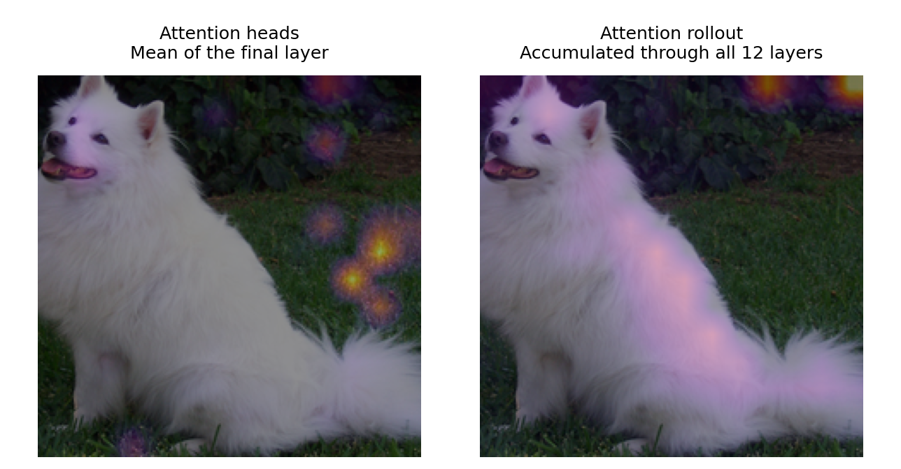
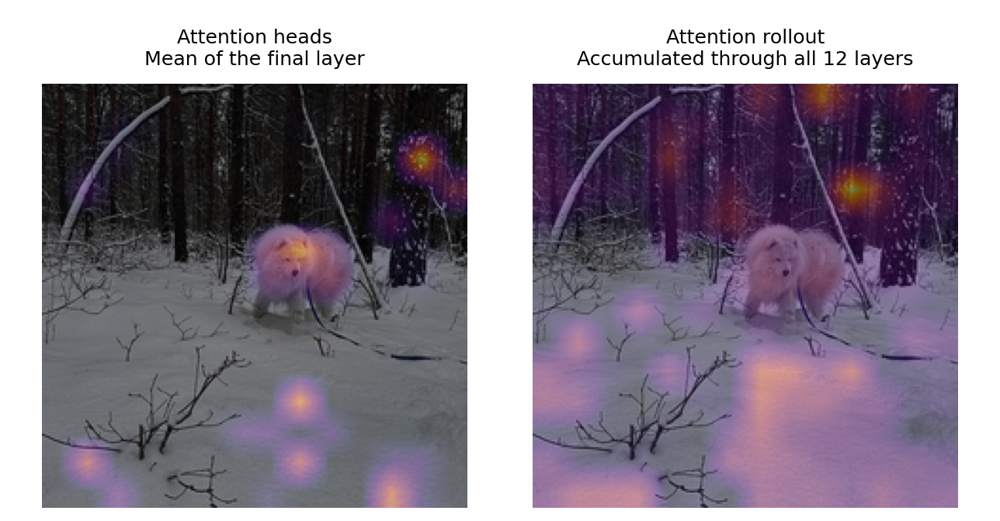

# Attention Heads vs Attention Rollout

A Wolfram Language comparison of final-layer attention heads and attention rollout in a Vision Transformer.

Start with [AttentionHeadsAndRollout.nb](AttentionHeadsAndRollout.nb). It includes four dog photographs, a layer-by-layer plot, and a small worked example explaining the matrix multiplication behind rollout.

## Examples

The left panel averages the final layer's attention heads. The right panel accumulates attention through all twelve layers. Both show the model's actual 224 × 224 crop, with contrast adjusted separately.



The PyTorch Hub dog is classified as Samoyed with 75.2% probability.



The winter photograph is labeled Samoyed at its source, but the model predicts Great Pyrenees at 83.0%, with Samoyed second at 10.1%. The background highlights raise a question about the influence of scene context. These attention maps do not establish what caused the breed error.

[Photo sources and credits](IMAGES.md).

## Reproduce the maps

Clone or download the whole repository. The cached tensors are included, so reproducing the maps does not require downloading model weights or running inference again.

Open the notebook in Wolfram, then evaluate this to recompute the maps:

```wolfram
Get[FileNameJoin[{NotebookDirectory[], "Reproduce.wl"}]];
example = ReproduceAttention["samoyed"];
{example["HeadMean"], example["Rollout"]}
```

Available examples:

| ID | Photograph | Top prediction |
|---|---|---|
| `samoyed` | PyTorch Hub dog | Samoyed, 75.2% |
| `samoyed-option-4` | Koira dog show | Samoyed, 85.0% |
| `samoyed-option-5` | Winter scene | Great Pyrenees, 83.0% |
| `samoyed-option-1` | Young dog on grass | Samoyed, 90.6% |

To regenerate the figures with Python, run these commands from the repository folder:

```sh
python -m pip install -r requirements.txt
python scripts/render_figures.py --image samoyed
```

The figures are written to `generated/samoyed/`. The Python script independently recomputes the maps and checks them against the saved Wolfram results.

Tested with Wolfram 15.0.1 and Python 3.14.3. [Reproduction details and checks](REPRODUCING.md) include the tensor format, normalization, and instructions for running inference again.

## References

- [Wolfram's Vision Transformer and attention visualization example](https://resources.wolframcloud.com/NeuralNetRepository/resources/Vision-Transformer-Trained-on-ImageNet-Competition-Data/)
- [Abnar and Zuidema, *Quantifying Attention Flow in Transformers* (2020)](https://aclanthology.org/2020.acl-main.385/)

Rollout averages heads, adds the identity for the residual route, normalizes rows, and multiplies successive layers on the left. It approximates routes through attention; it does not include every operation in the transformer or explain a particular class score.
